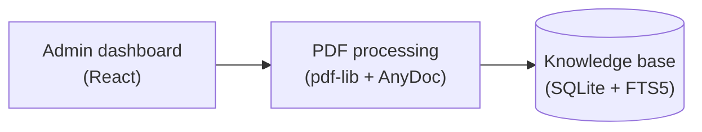
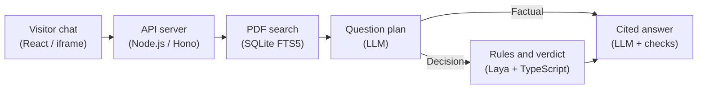

# Cogniva

Cogniva gives each organization a private PDF knowledge base and a shareable assistant. Visitors can ask for information or walk through a supported policy decision and see the document pages behind the answer.

## Architecture

Cogniva has two flows. An administrator builds the organization’s knowledge base, then visitors ask questions through its assistant. Each box names the process and the technology that implements it.

**Preparing the knowledge base**

**Answering a visitor**

LLM means large language model. OpenRouter, Gemini, or Ollama supplies the configured model. In policy checks, Laya runs Choice and Boolean decisions, while TypeScript handles numeric rules and combines the results.

| Component | Technology | What it does |
| --- | --- | --- |
| Admin dashboard | React | Gives each organization a screen to manage its PDFs, assistant link, and usage. |
| PDF processing | pdf-lib and AnyDoc | Extracts readable text and divides it into searchable passages while keeping page numbers. |
| Knowledge base | SQLite and FTS5 | Stores the PDFs and their passages and provides word-based search within one organization. |
| Visitor chat | React and an HTML iframe | Lets visitors ask questions on the assistant page or inside another website. |
| API server | Node.js and Hono | The web server handles API requests and validates the assistant token to identify the organization. |
| PDF search | SQLite FTS5 | Searches that organization’s passages for relevant words and keeps document and page references. |
| Question plan | Language model through OpenRouter, Gemini, or Ollama | Classifies the request, selects supporting passages, and breaks policy questions into individual checks. |
| Rules and verdict | Laya and TypeScript | Laya checks policy applicability and semantic conditions, then code compares numbers and combines the results. |
| Cited answer | Language model and server validation | Selects and checks source excerpts, then shows their document pages alongside any calculated verdict. |

## Run locally

Install Node.js 24.15+ in the Node 24 series, npm, and Git. The local System 1 service also uses Python 3.13 and [uv](https://docs.astral.sh/uv/getting-started/installation/). Use [Ollama](https://ollama.com/download) for local generation, or get an [OpenRouter key](https://openrouter.ai/settings/keys) or a [Gemini key](https://aistudio.google.com/apikey).

1. Run `npm ci`.
2. Copy `.env.example` to `.env` on first setup. Set `LLM_PROVIDER` to `ollama`, `openrouter`, or `gemini`. For a cloud provider, put its API key in the local file. For Ollama, start the Ollama app or run `ollama serve` in a separate terminal, then run `ollama pull qwen3:1.7b-q4_K_M` once. Cogniva generates a local signing secret under `data/` and initializes the SQLite schema on startup.
3. Run `npm run seed` to create two sample organizations. It generates two text-based PDFs for each organization under `data/demo-pdfs/` and writes the local login details to `data/demo-accounts.json`. The synthetic source content and 14 test questions are in [fixtures/demo.ts](fixtures/demo.ts).
4. In separate terminals, run `npm run laya` and `npm run dev`. The first Laya startup downloads the English checkpoint. Open [the dashboard](http://localhost:5173) to register or sign in as a demo organization.
5. Run `npm run demo` in another terminal and open the [sample visitor help center](http://localhost:5174). In the dashboard, open **Visitor assistant** and click **Copy embed**. Paste the code into the sample page and click **Load assistant**. The example lives in [scripts/embed-demo.html](scripts/embed-demo.html).

`npm test` exercises real SQLite, authentication, PDF parsing, and the HTTP routes with deterministic model stubs. `npm run build` type-checks the application and bundles the client. To serve the bundle locally, run `COGNIVA_ORIGIN=http://localhost:3001 npm start` after building.

| Environment variable | Purpose |
| --- | --- |
| `LLM_PROVIDER` | Selects `openrouter` (default), `gemini`, or `ollama` for planning and answer generation. |
| `OPENROUTER_API_KEY` | Server-side credential when using OpenRouter. |
| `OPENROUTER_MODEL` | Defaults to `nvidia/nemotron-3.5-super-vl:free`. Use a model that supports strict JSON schemas. |
| `GOOGLE_GEMINI_API_KEY` | Server-side credential when using Gemini. |
| `GOOGLE_GEMINI_MODEL` | Defaults to `gemini-3.1-flash-lite`. Use a model with structured output support. |
| `OLLAMA_URL` | Ollama server, normally `http://127.0.0.1:11434`. |
| `OLLAMA_MODEL` | Local model tag, normally `qwen3:1.7b-q4_K_M`. Pull the selected model before starting Cogniva. |
| `LAYA_URL` | Local decision service, normally `http://127.0.0.1:8000`. |
| `PORT` | API port, normally `3001`. |
| `COGNIVA_ORIGIN` | Allowed dashboard origin, normally `http://localhost:5173`. |
| `COGNIVA_DB_PATH` | SQLite file, normally `data/cogniva.sqlite`. |
| `COGNIVA_SECRET` | Optional stable server secret of at least 32 characters. A local secret file is created otherwise. |

Change `LLM_PROVIDER` in `.env` and restart `npm run dev` to switch providers. Cogniva sends generation requests only to the selected provider. Ollama generation uses the local server and requires no API key. Laya handles local typed decisions with all three providers.

## Knowledge base

The server validates the PDF signature, a 10 MB file limit of 10,000,000 bytes, a 20-page limit, and a 10-document organization quota. `pdf-lib` separates pages, then AnyDoc extracts Markdown locally. The server splits page text into overlapping passages of up to 1,100 characters and indexes them in SQLite FTS5. Every passage keeps its original page number and document name. A ready replacement swaps in its chunks and deletes the previous version in one transaction. A failed replacement leaves the original indexed.

Search uses English word stemming, so words such as “reserve” and “reserved” can match. Questions with three or more search terms require at least two matching terms across the organization’s knowledge base. This reduces answers based on a single shared word while preserving questions that span several PDFs. Tables and the search index are created automatically for each fresh local database.

## AI decisions and grounding

The API resolves the tenant before retrieval. It returns a no-answer response when search finds no evidence. Otherwise the LLM planner selects evidence and classifies the question. Factual questions go straight to composition. For a decision, the planner extracts conditions and their combination from the retrieved passages. It quotes the rules from the PDFs and the visitor facts from the question.

The server validates those quotes before running a decision. Laya **Choice** is an applicability check for the cited policy, with “applies” and “unclear” as its two options. Laya **Boolean (Noul)** evaluates individual semantic conditions. Independent checks run in parallel. TypeScript performs numeric comparisons and combines the checks using the policy’s required or alternative conditions. Supported numeric forms include inclusive bounds, explicit ranges, allowed-value lists, and compatible units and scales. Numeric rules the code cannot interpret yield an uncertain check. Missing facts lead to clarification. The composer selects the cited rules while the UI renders the computed verdict and a trace of the typed outputs.

For factual replies, the model supplies a passage ID and a supporting quote. The server checks the exact quote against the retrieved passage and displays the verified excerpt with its document and page reference. This keeps the displayed factual text tied to its source. For multi-part questions, the composer is instructed to include every part and identify unsupported parts. Coverage of every part still depends on the model’s output.

The current score thresholds are provisional. A Choice score of 0.60 is required for applicability, and Noul scores between 0.35 and 0.65 yield uncertainty. If applicability is uncertain, the overall verdict is uncertain because a rule failure establishes a negative outcome only for a policy that applies. These scores need calibration on labeled policy cases before they can be treated as reliable confidence estimates.

## Security

Better Auth manages email/password login and admin sessions. Administrative routes require an owner or admin membership in the resolved organization. Public assistant tokens authorize questions against one organization and identify the organization displayed in the chat. The server stores a hash for token lookup and encrypts the token for redisplay in the dashboard. Rotation invalidates the old token. If the signing secret changes and the saved token cannot be decrypted, the dashboard offers regeneration. File downloads, replacements, deletes, and retrieval are scoped by organization. Dashboard pages reject iframe embedding, while the visitor assistant supports it. The public response includes short cited passages and a rate limit applies per assistant organization.

`.env` and the SQLite, secret, and generated demo files under `data/` are ignored by Git. The selected cloud provider receives the visitor's question and selected passages for planning and composition. Use the synthetic fixture material for the free model demo. AnyDoc and Laya run locally.

## Main API endpoints

| Endpoint | Purpose |
| --- | --- |
| `/api/auth/*` | Better Auth accounts, sessions, and organization creation. |
| `GET /api/admin/dashboard` | Organization, document statuses, usage counters, and current assistant token. |
| `POST /api/admin/assistant` | Generate or rotate the assistant token. |
| `POST /api/admin/documents` | Upload and index a PDF. |
| `GET /api/admin/documents/:id/file` | Download the original PDF with an authorized session. |
| `PUT /api/admin/documents/:id` | Upload and index a replacement. |
| `POST /api/admin/documents/:id/retry` | Retry a failed ingestion. |
| `DELETE /api/admin/documents/:id` | Delete a PDF and its index entries. |
| `POST /api/assistant` | Resolve the organization’s display name from an assistant token. |
| `POST /api/ask` | Ask a question with an assistant token. |

## Known limitations

This is a single-process local MVP with synchronous ingestion, text-based PDFs, and keyword retrieval. OCR, a worker queue for ingestion, and hybrid search would extend the supported documents and workloads. Policy decisions are limited to cases the planner can represent as a supported combination of simple checks. Conflicting, ambiguous, or complex policies may yield a cited summary or an uncertain result. Decision confidence is heuristic and needs evaluation on more labeled cases. Cloud free tiers are subject to rate limits and availability.

The 20-request-per-minute organization budget protects the local demo’s model quota, but one visitor can consume it. Visitor-level limits are a future improvement. Retrieval overlap and verbatim citations establish source provenance. Selecting the right passage and covering every subquestion still depend on the planner and composer. The small Ollama model has missed subquestions and selected irrelevant passages during local testing.

## Validation and remaining work

`npm test` uses real SQLite, PDF processing, authentication, and API routes with controlled model responses. Regression checks cover numeric boundaries and unsupported rules, claim text, tenant isolation, token recovery, and usage outcomes. GitHub Actions runs the build and these tests for pushes and pull requests.

The dashboard separates answered, unanswered, needs-clarification, needs-review, and service-error counts. In-progress requests count as asked until they finish.

A complete recorded evaluation with the chosen language model and Laya is still needed. Run the 14 sample questions and a labeled set of 20–30 additional cases, record the provider and model versions, outputs, correctness, and elapsed time, then review the score thresholds. Include both positive and negative decisions, missing facts, threshold boundaries, unsupported questions, long questions, and injected instructions in PDF text. Local model calls have been exercised during development, including successful answers and decision-path failures. End-to-end reliability across this evaluation set remains unmeasured.

The 8–15 minute demo video is part of the assignment submission and is recorded separately.

## Demo walkthrough

1. Sign up as a new organization, upload a PDF, and show the document status and assistant link.
2. Open the seeded Northbridge dashboard, paste its embed into the separate page, and ask when the library opens. Open the page citation.
3. Ask both multi-condition scholarship questions from the fixture list. Expand **How Cogniva decided** and explain the conditions extracted from the PDFs, Laya's outputs, and the TypeScript combination. The same workflow can process rules from other domains.
4. Ask for the Northbridge library desk code using both organizations' assistants. Northbridge has the code, while Harborlight's knowledge base gives no answer. Show a Harborlight-specific question too.
5. Explain the architecture diagram, invalid-token behavior, and the isolation tests. The assignment video is approximately 8–15 minutes.
