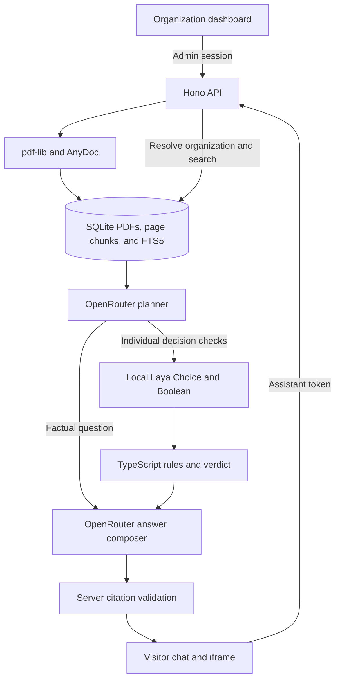

# Cogniva

Cogniva gives each organization a private PDF knowledge base and a shareable assistant. Visitors can ask for information or walk through a supported policy decision and see the document pages behind the answer.

## Run locally

Install Node.js 24.15+ in the Node 24 series, npm, and Git. The local System 1 service also uses Python 3.13 and [uv](https://docs.astral.sh/uv/getting-started/installation/). Get an [OpenRouter key](https://openrouter.ai/settings/keys) for live language-model calls.

1. Run `npm ci`.
2. Copy `.env.example` to `.env` and fill in `OPENROUTER_API_KEY`. Keep the key in the local file. Cogniva generates a local signing secret under `data/` and initializes the SQLite schema on startup.
3. Run `npm run seed` to create two sample organizations. It generates two text-based PDFs for each organization under `data/demo-pdfs/` and writes the local login details to `data/demo-accounts.json`. The synthetic source content and 14 test questions are in [fixtures/demo.ts](fixtures/demo.ts).
4. In separate terminals, run `npm run laya` and `npm run dev`. The first Laya startup downloads the English checkpoint. Open [the dashboard](http://localhost:5173) to register or sign in as a demo organization.
5. Run `npm run demo` in another terminal, copy the dashboard's iframe code, and paste it into [the separate demo page](http://localhost:5174).

`npm test` exercises real SQLite, authentication, PDF parsing, and the HTTP routes with deterministic model stubs. `npm run build` type-checks the application and bundles the client. To serve the bundle locally, run `COGNIVA_ORIGIN=http://localhost:3001 npm start` after building.

| Environment variable | Purpose |
| --- | --- |
| `OPENROUTER_API_KEY` | Server-side credential for live planning and answer generation. |
| `OPENROUTER_MODEL` | Defaults to `nvidia/nemotron-3.5-super-vl:free`. Use a model that supports strict JSON schemas. |
| `LAYA_URL` | Local decision service, normally `http://127.0.0.1:8000`. |
| `PORT` | API port, normally `3001`. |
| `COGNIVA_ORIGIN` | Allowed dashboard origin, normally `http://localhost:5173`. |
| `COGNIVA_DB_PATH` | SQLite file, normally `data/cogniva.sqlite`. |
| `COGNIVA_SECRET` | Optional stable server secret of at least 32 characters. A local secret file is created otherwise. |

## Architecture

### Knowledge base

The API validates the PDF signature, file size, page count, and organization quota. `pdf-lib` separates pages, then AnyDoc extracts Markdown locally. The server splits page text into bounded, overlapping chunks and indexes them in SQLite FTS5. Every passage keeps its original page number and document name. A ready replacement swaps in its chunks and deletes the previous version in one transaction. A failed replacement leaves the original indexed.

### AI decisions and grounding

The API resolves the tenant before retrieval. If search returns no evidence, it responds directly. Otherwise the OpenRouter planner selects evidence and classifies the question. Factual questions can go straight to composition. The demonstrated individual decision workflow is Academic Merit Scholarship eligibility.

For that workflow, Laya **Choice** checks the policy category. Laya **Boolean (Noul)** judges whether the existing award is athletics-based. These judgments are submitted together against the same state. TypeScript reads the supported rules from the cited passages, compares the visitor's year and GPA, and combines the checks. Missing facts lead to clarification, and an ambiguous Laya output can lead to an uncertain verdict. The composer explains the grounded rules while the UI renders the computed verdict and a trace of the typed outputs. The trace exposes model outputs and rule results, with no private reasoning.

For generated claims, the model supplies a passage ID and a verbatim supporting quote. The server validates both against the retrieved ledger before returning document and page references. The answer composer can also report insufficient evidence.

### Security

Better Auth manages email/password login and admin sessions. Administrative routes require an owner or admin membership in the resolved organization. Public assistant tokens authorize questions against one organization. The server stores a hash for token lookup and encrypts the token for redisplay in the dashboard. Rotation invalidates the old token. File downloads, replacements, deletes, and retrieval are scoped by organization. The public response includes short cited passages and a rate limit applies per assistant organization.

`.env` and the SQLite, secret, and generated demo files under `data/` are ignored by Git. OpenRouter receives the visitor's question and selected passages for planning and composition. Use the synthetic fixture material for the free model demo. AnyDoc and Laya run locally.

### Main API endpoints

| Endpoint | Purpose |
| --- | --- |
| `/api/auth/*` | Better Auth accounts, sessions, and organization creation. |
| `GET /api/admin/dashboard` | Organization, document statuses, usage counters, and current assistant token. |
| `POST /api/admin/assistant` | Generate or rotate the assistant token. |
| `POST /api/admin/documents` | Upload and index a PDF. |
| `GET /api/admin/documents/:id/file` | Download the original PDF with an authorized session. |
| `PUT /api/admin/documents/:id` | Upload and index a replacement. |
| `POST /api/admin/documents/:id/retry` | Retry a failed ingestion. |
| `DELETE /api/admin/documents/:id` | Delete a PDF and its index entries. |
| `POST /api/ask` | Ask a question with an assistant token. |

### Known limitations

This is a single-process local MVP with synchronous ingestion, text-based PDFs, and keyword retrieval. OCR, a worker queue for ingestion, and hybrid search would extend the supported documents and workloads. The registered policy workflow covers the sample merit scholarship format. Other organizations can use document-grounded Q&A. Decision confidence is heuristic and needs evaluation on more labeled cases. OpenRouter's free route is subject to rate limits and availability.

## Demo walkthrough

1. Sign up as a new organization, upload a PDF, and show the document status and assistant link.
2. Open the seeded Northbridge dashboard, paste its embed into the separate page, and ask when the library opens. Open the page citation.
3. Ask both multi-condition scholarship questions from the fixture list. Expand **How Cogniva decided** and explain Laya's outputs and the TypeScript combination.
4. Ask for the Northbridge library desk code using both organizations' assistants. Northbridge has the code, while Harborlight's knowledge base gives no answer. Show a Harborlight-specific question too.
5. Explain the architecture diagram, invalid-token behavior, and the isolation tests. The assignment video is approximately 8–15 minutes.
