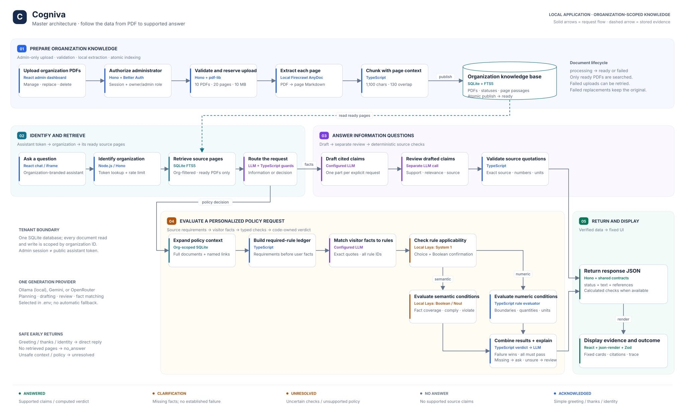
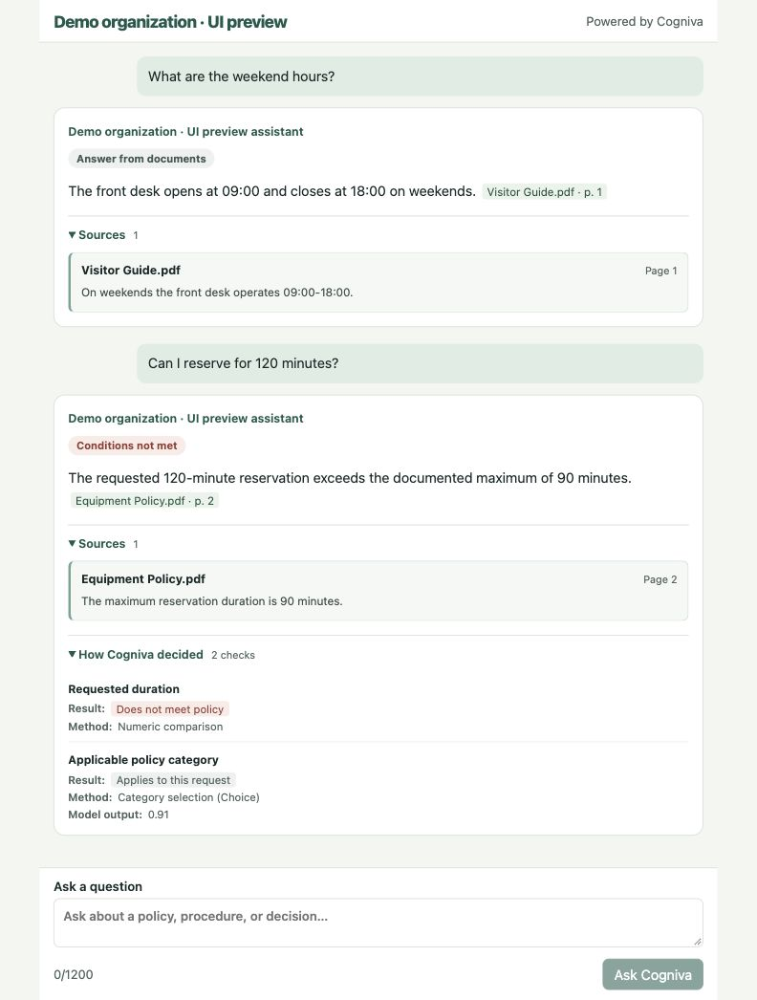

# Cogniva

Cogniva gives each organization a private PDF knowledge base and a shareable assistant. Visitors can ask for information or walk through a supported policy decision and see the document pages behind the answer.

## Architecture

A single view of PDF ingestion, organization-scoped retrieval, factual verification, and policy decisions.



Open [architecture.html](architecture.html) locally to zoom, pan, highlight a flow, or select a step for its implementation details. No app startup is needed. The [editable draw.io file](docs/architecture.drawio) contains native shapes and connectors; the [SVG](docs/images/architecture.svg) is available for presentations.

## Chat preview



*UI preview using local test responses.*

## Run locally

Install Node.js 24.15+ in the Node 24 series, npm, and Git. The local System 1 service also uses Python 3.13 and [uv](https://docs.astral.sh/uv/getting-started/installation/). Use [Ollama](https://ollama.com/download) for local generation, or get an [OpenRouter key](https://openrouter.ai/settings/keys) or a [Gemini key](https://aistudio.google.com/apikey).

1. Run `npm ci`.
2. Copy `.env.example` to `.env` on first setup. Set `LLM_PROVIDER` to `ollama`, `openrouter`, or `gemini`. For a cloud provider, put its API key in the local file. For Ollama, start the Ollama app or run `ollama serve` in a separate terminal, then run `ollama pull qwen3:1.7b-q4_K_M` once. Cogniva generates a local signing secret under `data/` and initializes the SQLite schema on startup.
3. Run `npm run seed` to create two sample organizations. It generates two text-based PDFs for each organization under `data/demo-pdfs/` and writes the local login details to `data/demo-accounts.json`. The synthetic source content and 14 test questions are in [fixtures/demo.ts](fixtures/demo.ts).
4. In separate terminals, run `npm run laya` and `npm run dev`. The first Laya startup downloads the English checkpoint. Wait until it prints **Choice and Boolean checks are warmed up** before asking questions. Open [the dashboard](http://localhost:5173) to register or sign in as a demo organization.
5. Run `npm run demo` in another terminal and open the [sample visitor help center](http://localhost:5174). In the dashboard, open **Visitor assistant** and click **Copy embed**. Paste the code into the sample page and click **Load assistant**. The example lives in [scripts/embed-demo.html](scripts/embed-demo.html).

`npm test` exercises real SQLite, authentication, PDF parsing, and the HTTP routes with deterministic model stubs. `npm run build` type-checks the application and bundles the client. To serve the bundle locally, run `COGNIVA_ORIGIN=http://localhost:3001 npm start` after building.

| Environment variable | Purpose |
| --- | --- |
| `LLM_PROVIDER` | Selects `openrouter` (default), `gemini`, or `ollama` for planning, answer generation, and factual answer review. |
| `OPENROUTER_API_KEY` | Server-side credential when using OpenRouter. |
| `OPENROUTER_MODEL` | Defaults to `nvidia/nemotron-3.5-super-vl:free`. Use a model that supports strict JSON schemas. |
| `GOOGLE_GEMINI_API_KEY` | Server-side credential when using Gemini. |
| `GOOGLE_GEMINI_MODEL` | Defaults to `gemini-3.1-flash-lite`. Use a model with structured output support. |
| `OLLAMA_URL` | Ollama server, normally `http://127.0.0.1:11434`. |
| `OLLAMA_MODEL` | Local model tag, normally `qwen3:1.7b-q4_K_M`. Pull the selected model before starting Cogniva. |
| `LAYA_URL` | Local decision service, normally `http://127.0.0.1:8000`. |
| `PORT` | API port, normally `3001`. |
| `COGNIVA_ORIGIN` | Allowed dashboard origin, normally `http://localhost:5173`. |
| `COGNIVA_DB_PATH` | SQLite file, normally `data/cogniva.sqlite`. |
| `COGNIVA_SECRET` | Optional stable server secret of at least 32 characters. A local secret file is created otherwise. |

Change `LLM_PROVIDER` in `.env` and restart `npm run dev` to switch providers. Cogniva sends generation requests only to the selected provider. Ollama generation uses the local server and requires no API key. Laya handles local typed decisions with all three providers.

## Knowledge base

The server validates the PDF signature, a 10 MB file limit of 10,000,000 bytes, a 20-page limit, and a 10-document organization quota. `pdf-lib` separates pages, then AnyDoc extracts Markdown locally. The server splits page text into overlapping passages of up to 1,100 characters and indexes them in SQLite FTS5. Every passage keeps its original page number and document name. A ready replacement swaps in its chunks and deletes the previous version in one transaction. A failed replacement leaves the original indexed.

Search uses English word stemming, so words such as “reserve” and “reserved” can match. It ranks matching chunks and reconstructs up to six source pages, retaining nearby qualifiers and policy context. A single matching search term can retrieve a page; this supports ordinary wording such as “opening hours.” The LLM must still select an answer relevant to the question. Tables and the search index are created automatically for each fresh local database.

## AI decisions and grounding

The API resolves the organization from the assistant token before searching. The LLM classifies the question and selects evidence IDs from a schema restricted to the actual retrieved IDs. Application guards keep procedural and general information requests on the factual path and force clear personalized eligibility questions through policy checking.

For a policy question, the server reads every page of the selected documents and follows exact document-title cross-references inside the same organization. It constructs a ledger of source sentences expressing requirements, limits, or prohibitions **before matching visitor facts**. Headings without a threshold or obligation provide context rather than extra checks. A per-session numeric summary card repeated by a detailed rule on the same page is consolidated when its subject, units, limit and period match. Every ledger ID is required in the fact-matching schema. The model cannot shorten the list by omitting a condition. Visitor facts must be contiguous quotes from the visitor's question, retaining quantities and units. For missing or ungrounded numeric facts, one bounded correction can select only from numbered excerpts of the actual visitor text, never invent a threshold or value. Numeric comparisons use the original source rule.

Laya **Choice** classifies whether each rule applies. A separate **Boolean (Noul)** applicability check must corroborate an exclusion, and every exclusion remains in the decision trace. Categories come from the source subjects, headings, and purpose clauses. The LLM fact matcher cannot redefine them. Category interpretation can still be uncertain, including for initial application versus renewal. For semantic conditions, separate Boolean checks look for compliance and an explicit violation. Lack of evidence is not automatically a violation. Exactly one supported Boolean outcome decides the result; conflicting or inconclusive outputs require review. Failed semantic checks display the violation score in the trace. There is no model-supplied `expected: false` flag that could reverse a prohibition.

TypeScript handles clear numeric thresholds, inclusive boundaries, ranges, allowed-value lists, and compatible units and scales. A numeric form the parser cannot safely interpret stays uncertain. Separate source requirements are combined with **all**: one established failure prevents approval; missing facts prompt clarification; approval requires every applicable check to pass. Alternatives inside a source sentence remain intact. Recognized complex structures such as “either of the following” or exception overrides return an unresolved response rather than accepting an invented combination.

Independent Laya inputs run through its batch endpoint in groups of four, with short instructions and bounded context. Calls are serialized at the adapter to avoid competing CPU requests. `npm run laya` waits for health and performs real Choice and Boolean warm-up checks before reporting readiness. This avoids the previous cold-start and queued-request timing problem; it does not guarantee that every inference or external API request will succeed.

The answer composer receives the **calculated verdict and checks**. For factual answers, one separate structured call to the selected LLM reviews each candidate's support and relevance, using the full question and actual cited source pages. It can select a corrected quotation from that same page. The server validates the selected quotation against the real page and checks numeric values coupled to their explicit units and currencies before accepting a paraphrase. If semantic support and relevance pass but the numeric check fails, the original source wording is used. Conflicting support and excerpt-relevance assessments require review; clearly irrelevant claims are discarded. An excerpt-relevance vote cannot override an unsupported claim. Relevance remains model-dependent: an exact quote does not prove it answers the question. Laya remains responsible for structured policy checks rather than acting as a universal factual-answer veto.

Decision replies retain verified policy excerpts beside the calculated verdict, so generated approval wording cannot override it. Explicit question parts are tracked in application code, and a missing part gets a clear unsupported-information message alongside supported answers. Inconclusive or unavailable factual verification returns `unresolved`, not a claim that the PDFs lack the information. No supporting evidence found returns `no_answer`. The extra factual review and optional numeric fact correction use the configured provider and consume its normal quota; there are no automatic provider fallbacks or unbounded retries.

Model scores are provisional thresholds, not calibrated probabilities of correctness. Most semantic policy checks require a Noul score of at least 0.65. Source provenance and semantic relevance are separate: a valid quote can still answer the wrong question. The factual review is another model judgment, not a proof; using the same small LLM can produce correlated mistakes. Question interpretation, applicability, passage selection, and factual review require live evaluation with the chosen model.

## Security

Better Auth manages email/password login and admin sessions. Administrative routes require an owner or admin membership in the resolved organization. Public assistant tokens authorize questions against one organization and identify the organization displayed in the chat. The server stores a hash for token lookup and encrypts the token for redisplay in the dashboard. Rotation invalidates the old token. If the signing secret changes and the saved token cannot be decrypted, the dashboard offers regeneration. File downloads, replacements, deletes, and retrieval are scoped by organization. Dashboard pages reject iframe embedding, while the visitor assistant supports it. The public response includes short cited passages and a rate limit applies per assistant organization.

`.env` and the SQLite, secret, and generated demo files under `data/` are ignored by Git. The selected cloud provider receives the visitor's question and selected passages for planning, composition and factual review. Use the synthetic fixture material for the free model demo. AnyDoc and Laya run locally.

## Main API endpoints

| Endpoint | Purpose |
| --- | --- |
| `/api/auth/*` | Better Auth accounts, sessions, and organization creation. |
| `GET /api/admin/dashboard` | Organization, document statuses, usage counters, and current assistant token. |
| `POST /api/admin/assistant` | Generate or rotate the assistant token. |
| `POST /api/admin/documents` | Upload and index a PDF. |
| `GET /api/admin/documents/:id/file` | Download the original PDF with an authorized session. |
| `PUT /api/admin/documents/:id` | Upload and index a replacement. |
| `POST /api/admin/documents/:id/retry` | Retry a failed ingestion. |
| `DELETE /api/admin/documents/:id` | Delete a PDF and its index entries. |
| `POST /api/assistant` | Resolve the organization’s display name from an assistant token. |
| `POST /api/ask` | Ask a question with an assistant token. |

## Known limitations

This is a single-process local MVP with synchronous ingestion, text-based PDFs, and keyword retrieval. OCR, background ingestion workers, and hybrid retrieval would extend the supported documents and workloads. Current reading budgets are six retrieved pages, 16,000 characters of context, and 32 candidate policy rules. A policy exceeding the budget receives an unresolved response; it is not silently shortened into an approval.

The rule ledger recognizes common English requirement and prohibition wording. It is not a formal compiler for arbitrary policies. Unusual formatting, implicit requirements, exceptions, conflicting policies, nested alternatives, and multi-variable arithmetic can require human review. The system may conservatively ask for facts that do not actually apply. Applicability and semantic scores need calibration on a larger labeled dataset. A local model can be too weak for reliable interpretation even when all JSON schemas are valid.

The 20-question-per-minute organization limit protects the local demo, but one visitor can consume it. Visitor-level limits, a durable job queue, richer policy representations, observability, and production database operations would be later improvements. Free cloud APIs remain subject to quota and availability; Cogniva does not automatically switch to a paid provider.

## Validation and evaluation

`npm test` uses real SQLite, PDF processing, authentication, and HTTP routes with controlled model outputs, plus client answer-card regressions for citations, verdict tones, catalog fallback, and source reveal. Server regressions cover omitted mandatory conditions, factual-route bypass, prohibition polarity, conservative combination, verdict-aware composition, full-document policy context, batch truncation, tenant isolation, upload limits, token recovery, and usage counters. `npm run build` checks TypeScript and builds the client. GitHub Actions runs the build and deterministic tests.

The additional [fictional knowledge base](fixtures/knowledge-base) contains **three organizations with three PDFs each**. Its policies differ from the smaller original seed fixtures. [fixtures/evaluation.json](fixtures/evaluation.json) contains 17 labeled cases spanning direct information, procedures, comparisons, multi-source and mixed supported/unsupported questions, missing facts, numeric failures, and an unrelated-organization question.

Run live checks separately from unit tests:

```sh
# Local generation; requires the model to be installed and Laya warmed up.
npm run evaluate -- --provider ollama --cases n-hours,h-book,h-compare,m-hours,m-mixed,m-unknown,m-isolation,h-limit,m-limit

# Gemini: use your free-tier project; requests are paced and stop on quota errors.
npm run evaluate -- --provider gemini --max-cloud-calls 40

# Smaller original fixtures; known decision failures remain in the report.
npm run evaluate -- --demo --provider gemini --cases s-explicit-pass,s-explicit-fail --max-cloud-calls 6

# OpenRouter: the runner verifies zero prompt/output prices and requires a :free model.
npm run evaluate -- --provider openrouter --cases n-missing,n-fail --max-cloud-calls 6
```

The evaluator creates a temporary in-memory database, registers test organizations, uploads the actual PDFs through the API, and records responses, stage outputs, verdicts, and timings. It leaves the normal local database untouched. The default report is `data/evaluation/latest.json`, ignored by Git. Cloud evaluation defaults to a 12-call cap, makes no automatic retries, and stops on rate-limit errors. Paid OpenRouter models are rejected. The Gemini runner cannot inspect project billing: use the free-tier project and key you configured. Google lists free-tier text input and output for the configured model in its [pricing documentation](https://ai.google.dev/gemini-api/docs/pricing#gemini-3.1-flash-lite).

Acceptance checks use expected statuses, verdicts, and text fragments. Review the saved answers and references manually; a matching fragment alone is not proof of correctness. Measured results and remaining failures are recorded in [the validation report](docs/validation-report.md). The dashboard separates answered, unanswered, needs-clarification, needs-review, and service-error counts.

The 8–15 minute demo video is recorded separately.

## Demo walkthrough

1. Sign up as a new organization, upload a PDF, and show the document status and assistant link.
2. Open the seeded Northbridge dashboard, paste its embed into the separate page, and ask when the library opens. Open the page citation.
3. Ask both multi-condition scholarship questions from the fixture list. Expand **How Cogniva decided** and explain the source-derived condition ledger, Laya's typed outputs, and the TypeScript combination. The same workflow can process rules from other domains.
4. Ask for the Northbridge library desk code using both organizations' assistants. Northbridge has the code, while Harborlight's knowledge base gives no answer. Show a Harborlight-specific question too.
5. Explain the architecture diagram, invalid-token behavior, and the isolation tests. The assignment video is approximately 8–15 minutes.
